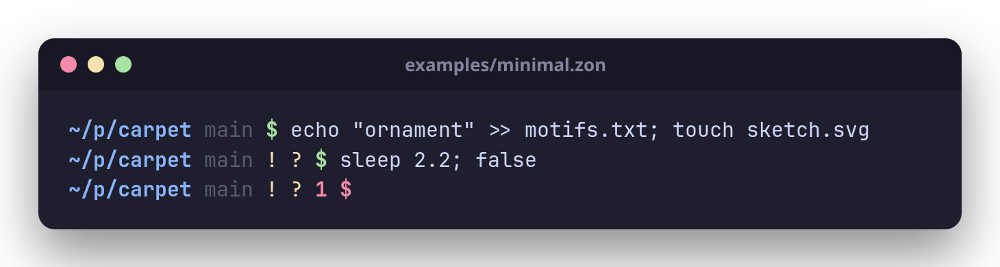
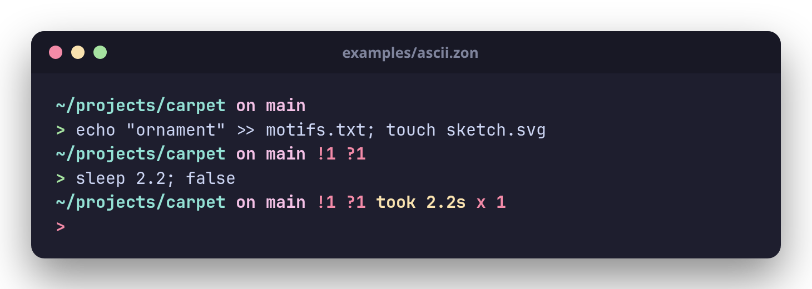
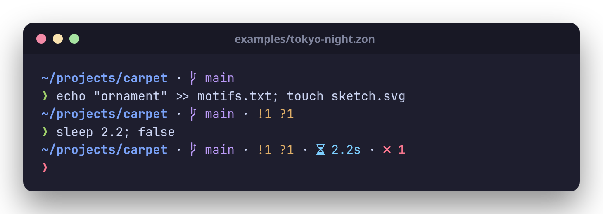
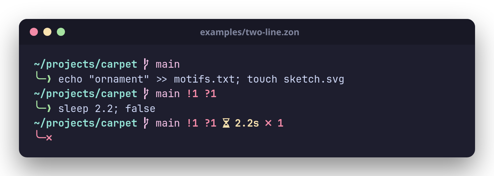

# butaglyph

A fast, shell-agnostic prompt engine written in Zig, in the spirit of
Starship and Oh My Posh. The command is `buta`. It runs on Linux, macOS
and Windows, in bash, zsh, fish and PowerShell.

<p align="center"></p>

* **Fast.** About 1 ms per prompt in a git repository, fork and exec
  included, with its own git reader (no `git` subprocess, no libgit2). An
  optional daemon caches the git modules and starts by itself.
* **Never broken, never slow.** Every module has a deadline. A module
  that fails or misses its deadline is left out, and the rest of the
  prompt is drawn.
* **Git-accurate.** Staged, modified, deleted, conflicted and untracked
  files (with `.gitignore` rules applied exactly as git applies them), and
  commits ahead of and behind the upstream. The test suite checks every
  answer against the real `git status`.

## The name

*Buta* is the teardrop-shaped motif woven into Azerbaijani carpets, and a
national symbol of Azerbaijan. butaglyph weaves small glyphs into your prompt
line the way buta motifs are woven into a carpet.

## Install

Requires Zig 0.16.0. There are no other dependencies.

**Linux and macOS**

```sh
git clone https://github.com/Huseynteymurzade28/butaglyph && cd butaglyph
zig build -Doptimize=ReleaseFast
install -Dm755 zig-out/bin/buta ~/.local/bin/buta
```

**Windows** (PowerShell)

```powershell
git clone https://github.com/Huseynteymurzade28/butaglyph; cd butaglyph
zig build -Doptimize=ReleaseFast
New-Item -ItemType Directory -Force "$HOME\.local\bin" | Out-Null
Copy-Item zig-out\bin\buta.exe "$HOME\.local\bin\"
# Put it on your PATH (once; takes effect in new terminals):
$userPath = [Environment]::GetEnvironmentVariable('Path', 'User')
[Environment]::SetEnvironmentVariable('Path', "$userPath;$HOME\.local\bin", 'User')
```

Zig cross-compiles, so any machine can build for any other:
`zig build -Doptimize=ReleaseFast -Dtarget=x86_64-windows` (or
`aarch64-macos`, `x86_64-linux`, ...). Pushing a `v*` tag makes the
release workflow publish binaries for Linux, macOS and Windows (x86-64
and ARM64). On macOS, a downloaded binary may need
`xattr -d com.apple.quarantine buta` before it runs.

The default glyph set needs a [Nerd Font](https://www.nerdfonts.com) and a
UTF-8 locale (otherwise the shell measures the glyphs in bytes, not columns,
and the cursor drifts). Without either, use `.glyphs = .ascii` or the
[`ascii` preset](#presets).

## Shell setup

| Shell      | Add to                       | Line                                                   |
|------------|------------------------------|--------------------------------------------------------|
| bash       | `~/.bashrc`                  | `eval "$(buta init bash)"`                             |
| zsh        | `~/.zshrc`                   | `eval "$(buta init zsh)"`                              |
| fish       | `~/.config/fish/config.fish` | `buta init fish \| source`                             |
| PowerShell | `$PROFILE`                   | `Invoke-Expression (& buta init powershell \| Out-String)` |

`buta init` prints a small hook script that records each command's exit
status and duration, then calls `buta prompt`. The script uses the absolute
path of the `buta` binary that generated it, so the hooks don't depend on
`$PATH`.

* **bash** uses `PROMPT_COMMAND` together with `PS0`. Command durations need
  bash ≥ 4.4, and millisecond precision needs bash ≥ 5.0 (`$EPOCHREALTIME`).
  Older versions still get every other module.
* **zsh** uses `preexec`/`precmd` and `$EPOCHREALTIME`. It also enables
  `prompt_subst`.
* **fish** uses `fish_postexec` and `$CMD_DURATION`, and defines `fish_prompt`.
* **PowerShell** (Windows PowerShell 5.1 and PowerShell 7+, on any
  platform) defines `prompt`. It reads the duration from the history,
  passes PowerShell's location with `--cwd` (it isn't the process's working
  directory), keeps `$?` and `$LASTEXITCODE` intact, and tells PSReadLine
  how tall a multi-line prompt is. `pwsh` is accepted as a name too.
* **Windows**: PowerShell is the native choice. Under Git Bash, MSYS2 or
  Cygwin, `buta init bash` (or zsh, fish) writes the path of `buta.exe`
  in `C:/...` form, which those shells can run; this is less tested than
  PowerShell. Paths are shown with `/` (`C:/Users/me/dev`, or `~/dev`
  under your profile directory).

<p align="center"></p>

You can also call `buta prompt` directly:

```sh
buta prompt --shell zsh --status 1 --duration-ms 5300 --jobs 2
```

## Configuration

buta reads its config from `$BUTA_CONFIG` if set, otherwise from
`$XDG_CONFIG_HOME/butaglyph/config.zon`, otherwise from
`~/.config/butaglyph/config.zon` (on Windows `~` is your profile directory,
`%USERPROFILE%`). The file is
[ZON](https://ziglang.org/documentation/master/#ZON) and every field is
optional. If the file is missing, buta uses the defaults. If the file is
invalid, buta prints one located error on stderr (e.g.
`config.zon:3:15: error: ...`) and draws the default prompt, so a broken
config never costs you the prompt.

```zig
.{
    // .nerd (default, needs a Nerd Font) or .ascii
    .glyphs = .nerd,
    // Modules in display order; modules left out are never computed.
    .order = .{ .dir, .git_branch, .git_status, .duration, .status, .jobs, .line_break, .character },
    .separator = " ",
    // Deadline for expensive modules (git), in ms from prompt start.
    .timeout_ms = 100,
    // The cache daemon: .auto (use it, start it when needed), .manual, .off
    .daemon = .auto,

    // Colors: "red", "bright_cyan", "208" (256-color), "#7aa2f7" (truecolor).
    // Style flags: bold, dim, italic, underline. Background: .bg.
    .dir = .{
        .style = .{ .fg = "#7aa2f7", .bold = true },
        .home_symbol = "~",
        .max_length = 24, // abbreviate once longer than this (0 = always)
        .abbrev_len = 1,  // ~/d/b/src: characters kept per directory
        .full_dirs = 2,   // trailing directories never abbreviated
    },
    .git_branch = .{ .style = .{ .fg = "magenta" }, .symbol = "on ", .max_length = 32, .timeout_ms = 50 },
    .git_status = .{ .style = .{ .fg = "red" }, .show_counts = true, .untracked = true, .ahead_behind = true },
    .status = .{ .style = .{ .fg = "red", .bold = true }, .signal_names = true },
    .duration = .{ .style = .{ .fg = "yellow" }, .min_ms = 2000 },
    .jobs = .{ .style = .{ .fg = "blue" } },
    .character = .{ .success_symbol = "❯", .failure_symbol = "✗" },
}
```

### Presets

[`examples/`](examples) holds ready-made configs. Use one with
`BUTA_CONFIG=/path/to/examples/minimal.zon`, or copy it to
`~/.config/butaglyph/config.zon` and change it from there.

| [`minimal`](examples/minimal.zon) | [`ascii`](examples/ascii.zon) |
|:---:|:---:|
|  |  |
| One line, no icons, any font. | The default layout in plain ASCII. |
| [`tokyo-night`](examples/tokyo-night.zon) | [`two-line`](examples/two-line.zon) |
|  |  |
| Truecolor, with `·` between segments. | Details above, the command below. |

### Modules

| Module       | Shows                                                         | Main options |
|--------------|---------------------------------------------------------------|--------------|
| `dir`        | Working directory, `$HOME` as `~`, fish-style abbreviation of long paths (UTF-8 aware). Windows drives and UNC roots are kept whole | `home_symbol`, `abbreviate`, `max_length`, `abbrev_len`, `full_dirs` |
| `git_branch` | Branch from `.git/HEAD`, or the short hash when HEAD is detached. Works in subdirectories, worktrees and submodules (`.git` files with `gitdir:`) | `symbol`, `detached_symbol`, `hash_length`, `max_length`, `timeout_ms` |
| `git_status` | Conflicted (`=`), staged (`+`), modified (`!`), deleted (`✘`) and untracked (`?`) paths, and commits ahead of (`⇡`) and behind (`⇣`) the upstream. Hidden when the tree is clean and in sync | `*_symbol`, `show_counts`, `untracked`, `ahead_behind`, `worktree`, `timeout_ms` |
| `status`     | The last exit code, if non-zero. `130` is shown as `INT`, and so on | `symbol`, `signal_names` |
| `duration`   | How long the last command ran, if longer than `min_ms`        | `symbol`, `min_ms` |
| `jobs`       | Number of background jobs. Not in the default order           | `symbol`, `min`, `count_from` |
| `character`  | The prompt symbol: green on success, red on failure           | `success_symbol`, `failure_symbol`, `*_style`, `suffix` |
| `line_break` | A newline, for multi-line prompts                             | none |

Every module except `line_break` has a `style` (or `success_style`/`failure_style`) and a
`symbol` override; leaving `symbol` unset uses the active glyph set.

Untracked files are counted like `git status` does: an untracked
directory counts once (`dir/`), and the repository's
`status.showUntrackedFiles` (`no`, `normal`, `all`) applies. Set
`.git_status = .{ .untracked = false }` to skip the walk of the work tree
altogether.

Set `BUTA_DEBUG=1` to have modules report their errors and missed
deadlines on stderr.

## The daemon

`buta daemon` keeps the git modules' results in memory and refreshes them
only when something in the repository changes, so a prompt in a large
repository costs about as much as one anywhere else. It runs on Linux
(inotify) and macOS (kqueue).

By default (`.daemon = .auto`) you don't have to do anything: when a
prompt finds no daemon, it starts `buta daemon --detach` in the background
and computes this one prompt itself; the next prompt asks the daemon. A
daemon that can't start is tried again only every 30 seconds, so it never
costs more than one process spawn per half minute. With `.daemon = .manual`
buta uses a daemon only if you started one, and with `.off` it never asks.

```sh
buta daemon --detach   # start it in the background
buta daemon status     # pid, cached repositories, watches, hits and misses
buta daemon stop       # with .daemon = .auto, a prompt restarts it after 30 s
```

`buta daemon` without `--detach` stays in the foreground, which suits a
systemd user service (`~/.config/systemd/user/buta.service`, then
`systemctl --user enable --now buta`; set `.daemon = .manual` then):

```ini
[Unit]
Description=butaglyph prompt cache

[Service]
ExecStart=%h/.local/bin/buta daemon
Restart=on-failure

[Install]
WantedBy=default.target
```

The socket is `$BUTA_SOCKET` if set (an empty `BUTA_SOCKET` turns the
daemon off for that shell), else `$XDG_RUNTIME_DIR/butaglyph.sock`, else
on macOS `$TMPDIR/butaglyph.sock` (both directories are private to you).
Otherwise there is no daemon.

**Upgrades.** Client and daemon compare a fingerprint of their protocol
and of every type that crosses the socket. A prompt from a different build
never trusts the daemon's answers and computes everything itself. When
that happens and the daemon's own executable has been replaced on disk
(an upgrade), the daemon exits, and the next prompt starts the new one.

* **Never stale.** A cached result is used only if the file system has
  reported no change in the repository since it was computed. The kernel
  queues an event before the syscall that caused it returns, and the
  daemon reads the queue before every lookup, so a command that has
  finished is always reflected in the next prompt. The test suite runs a
  long sequence of git operations (commits, stashes, branch switches,
  worktrees, `pack-refs`, moved directories, rapid same-size rewrites,
  untracked files, `.gitignore`, `info/exclude` and global excludes
  changes) and checks every prompt the daemon serves against a local
  computation.
* **Watches only what matters.** HEAD, the index, config, packed-refs,
  `info/exclude`, everything under `refs/`, your global git config and
  excludes files, and the work tree directories that are not ignored.
  Ignored directories (build output, `node_modules`) are not watched, so
  churn there costs nothing. kqueue can't see writes to the files in a
  watched directory, so on macOS every tracked file is watched too (one
  file descriptor each; the daemon raises its limit as far as the system
  allows). If the watches run out (`fs.inotify.max_user_watches` on
  Linux, file descriptors on macOS), that repository is simply not cached.
* **Never slower than its deadline.** The prompt sends its request
  before computing the cheap modules and waits for each answer only until
  that module's deadline. No daemon, a refused connection or a daemon from
  another build means computing locally; a daemon that hangs up early
  means computing locally whatever it didn't answer.
* **Private.** The daemon answers only processes of its own user, and on
  Linux only in its own mount namespace (a shell in a container computes
  locally).

## Design

* **The prompt never breaks.** If a module errors, it renders as empty and
  the rest of the prompt is drawn.
* **The prompt is never slow.** Modules that touch the filesystem
  (`expensive`: the git modules) run on worker threads, and each one has a
  deadline (`timeout_ms`, 100 ms by default). A module that misses its
  deadline is left out of that prompt. A late task is never waited for: it
  may be stuck in a syscall that can't be interrupted (a hung network
  mount, for example), so buta prints the prompt and exits, which ends the
  task. `cheap` modules do no I/O and run inline on the main thread,
  because dispatching them would cost more than computing them. If no
  expensive module is configured, no thread is started.
* **Computing and rendering are separate.** Each module's `compute`
  produces plain `Data` with no pointers into the process state. Its
  `render` is a pure function from `Data` to styled spans. Only
  `src/render.zig` knows about escape sequences. That is what lets the
  daemon compute `Data` in another process: modules that declare
  `scope = .repo` (their result depends only on the repository and their
  config) are served by it, and a module's `Config` and `Data` cross the
  socket through a small generic codec (`src/wire.zig`). Client and
  daemon compare a hash of all those types' shapes before talking.
* **Correct line editing.** Escape sequences are wrapped as zero-width
  (`\[ \]` in bash, `%{ %}` in zsh), so long input lines wrap correctly.
* **git without git.** `src/git/` reads repositories directly, with no
  libgit2 and no `git` subprocess. It handles `.git` files (worktrees and
  submodules), `commondir`, loose and packed refs, loose objects, and
  packfiles with OFS and REF deltas (memory-mapped `.idx`/`.pack`). It also
  reads the index (v2–v4, using the cache-tree extension to skip unchanged
  directories). Working-tree checks use `lstat`, and fall back to hashing
  the content when the stat data is inconclusive or "racy", as git does;
  `core.fileMode`, `core.symlinks`, `core.trustCtime` and `core.checkStat`
  are honored, and on Windows the stat fields Git for Windows doesn't
  record are left out. Large indexes are checked on several threads.
  Untracked files come from a walk of the work tree that never enters an
  ignored directory, with a port of git's `wildmatch` and its precedence
  rules (nested `.gitignore` files, `info/exclude`, `core.excludesFile`).
  Ahead/behind uses git's date-ordered merge-base paint. The test suite
  compares every result with the real `git status` and `git rev-list` on
  generated repositories (including random trees with random ignore rules),
  and checks that every object in loose, OFS-delta and REF-delta packs
  hashes back to its id.
* **Paths can't inject commands.** Text from the filesystem (directory and
  branch names) is quoted for the target shell, so a directory named
  `$(rm -rf ~)` is displayed, never executed. Control characters are
  replaced. The test suite checks this against real bash, zsh and fish.
* **Minimal allocation.** Every allocation on the prompt path comes from
  fixed buffers: one for the config, plus one per module so that modules on
  different threads never share an allocator. All of it is released
  together when the process exits.
  Output is written once, through a buffered writer.
* **One code base, three systems.** Paths are handled in `/` form
  everywhere (Windows accepts it), environment access goes through
  `src/env.zig` (Windows keeps its environment in UTF-16), and the
  daemon's system calls go through `src/sys.zig` (raw syscalls on Linux,
  libc on macOS) and `src/watch.zig` (inotify or kqueue).

```
src/
  main.zig           entry point, `init`, `prompt` and `daemon` commands
  cli.zig            argument parsing (lenient for `prompt`)
  env.zig            environment variables and paths on every platform
  daemon.zig         the cache daemon: socket, watches, cache
  client.zig         the prompt's side of the daemon protocol; autostart
  protocol.zig       messages, socket path, protocol fingerprint
  wire.zig           binary codec for module Config and Data
  sys.zig            Unix sockets, locks, processes (Linux and macOS)
  watch.zig          file change notification: inotify and kqueue
  context.zig        shared read-only input: cwd, env, status, duration, jobs
  module.zig         module interface, registry, compute/render drivers
  config.zig         ZON config loading
  glyphs.zig         Nerd Font and ASCII glyph sets
  render.zig         spans, ANSI, per-shell wrapping and quoting
  git/               the git reader (its own module, imported as "git")
    repo.zig         discovery, worktrees (.git files, commondir), HEAD
    refs.zig         loose refs, packed-refs, symbolic refs
    odb.zig          loose objects, packfiles, delta chains
    delta.zig        git's binary delta format
    object.zig       commit and tree parsing
    index.zig        index v2-v4 and the cache-tree extension
    config.zig       a small git-config reader
    ignore.zig       .gitignore rules and wildmatch
    untracked.zig    the work tree walk for untracked files
    status.zig       staged/modified/deleted/conflicted/untracked, ahead/behind
  modules/*.zig      one file per module
  shell/             init scripts (embedded with @embedFile)
examples/*.zon       presets
docs/tools/          scripts that regenerate the screenshots and the GIF
tests/integration.zig  drives the real binary and real shells
tests/git_compat.zig   compares the git reader with the real git CLI
tests/daemon.zig       checks the daemon's answers against local computation
bench/bench.zig        prompt latency benchmark
```

## Development

```sh
zig build test    # unit + integration tests (shell tests run for installed shells)
zig build bench   # 1000 × `buta prompt` in ReleaseFast: mean / p50 / p99
zig build bench -- 5000
tests/lineedit.sh bash   # interactive cursor check in tmux (also: zsh)
zig build test -Dtarget=x86_64-windows -fwine   # the Windows build, under wine
docs/tools/demo.sh       # regenerate docs/*.png and docs/demo.gif
```

CI (`.github/workflows/ci.yml`) runs the tests on Linux, macOS and Windows,
checks formatting and cross-compiles every release target.

Measured on the development machine (Linux, x86-64) with the daemon off,
including fork/exec. The target is a mean under 2 ms.

| Configuration                                      | Mean     | p99     |
|----------------------------------------------------|----------|---------|
| Default modules in this repo (git branch + status, untracked included) | ≈0.95 ms | ≈1.6 ms |
| No expensive module (no thread)                    | ≈0.39 ms | ≈0.8 ms |

Each worker thread costs ≈0.1 ms on this machine; that is the kernel cost
of creating it, measured with `std.Thread.spawn` on its own. `git_status`
grows with the number of tracked files, mostly because of one `lstat` per
file, and with the number of directories that aren't ignored (untracked
files need a walk). Best-of-15 wall time with `git_status` (before
untracked files were counted) was ≈3.1 ms on a 2.9k-file repo and ≈4.1 ms
on a 5.4k-file repo; `git status -uno` took 60–95 ms on the same repos.

With the daemon running, a cache hit is one round trip over the socket and
starts no thread. In one 2000-run benchmark in this repository (with a
dirty work tree), `buta prompt` took 0.08 ms more than `/bin/true` with the
daemon and 0.98 ms more without it. The cost no longer grows with the
repository; after a change, the first prompt pays for one recomputation in
the daemon.

## Roadmap

* **Phase 0 (done).** The CLI, the modules listed above, ZON config, glyph
  sets and the bash/zsh/fish integration.
* **Phase 1 (done): parallel modules with deadlines.** Expensive modules
  run concurrently through `std.Io`, each with its own deadline, and a
  module that misses it renders as empty. Only `module.computeAll`
  changed; the modules themselves did not.
* **Phase 2 (done): a native git reader.** HEAD, refs, the index, loose
  objects, packfiles and deltas, all without libgit2 or `git`. This powers
  `git_status`.
* **Phase 3 (done): a daemon.** `buta daemon` caches the git modules'
  data and watches repositories. `buta prompt` asks it over a Unix socket
  and computes directly when it isn't running. It is a subcommand rather
  than a separate `butad` binary, so client and daemon always come from
  the same build.
* **Phase 4 (done): everywhere, and complete.** Untracked files with
  exact `.gitignore` semantics; the daemon starts by itself and makes way
  after an upgrade; the daemon runs on macOS (kqueue); buta builds and
  runs on Windows, with PowerShell integration; presets, screenshots, CI
  on three systems and release binaries.

Known gaps:

* rename detection is not done, so a rename counts as a deletion plus an
  addition, as with `git status --no-renames`;
* clean/smudge filters (autocrlf, LFS) are not applied when hashing (on
  Windows with `core.autocrlf`, a file whose stat data changed but whose
  content didn't may show as modified until git refreshes the index);
* the system git config (`/etc/gitconfig`) and `[include]` are not read;
* not supported: SHA-256 repositories, reftable, split or sparse indexes,
  and object alternates. In any of these cases the module renders as empty;
* no daemon on Windows yet; prompts there are computed directly;
* on macOS, the daemon notices a global excludes file or git config file
  only if it existed when the repository's watches were set up.
