# butaglyph

A fast prompt for bash, zsh, fish and PowerShell, on Linux, macOS and
Windows. Pick one of ten looks, or weave your own with gradients,
segments and ornaments. The command is `buta`.

<p align="center">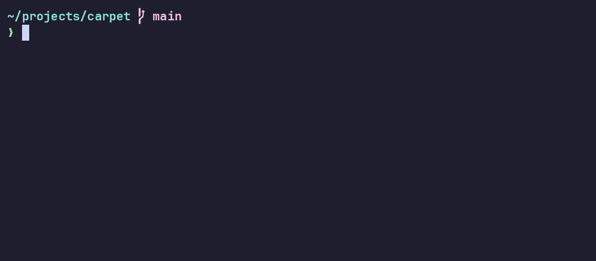</p>

* **Fast.** About 1 ms per prompt, with its own git reader (no `git`
  process). A small background daemon makes big repositories just as
  fast, and starts by itself.
* **Never in the way.** Anything slow or broken is left out of that one
  prompt; the rest is always drawn.
* **Knows your project.** Python (and its virtual environment), Node.js,
  Rust, Go and Zig versions, shown only where they matter, read from
  files or asked once and cached.
* **Knows where commands run.** AWS profile and region, Docker
  context, Kubernetes context and namespace, read from their config
  files.
* **Exact git status.** Staged, modified, deleted, conflicted and
  untracked files, ahead and behind, checked against the real `git status`.

*Buta* is the teardrop motif woven into Azerbaijani carpets. butaglyph
weaves small glyphs into your prompt the same way.

## Install

| System | How |
|---|---|
| Arch Linux | `yay -S butaglyph-bin` (prebuilt) or `yay -S butaglyph` (from source) |
| Linux, macOS | Download `buta-*-linux` or `buta-*-macos` from [Releases](https://github.com/Huseynteymurzade28/butaglyph/releases), put `buta` in `~/.local/bin` |
| Windows | See [Windows](#windows) below |
| From source | `zig build -Doptimize=ReleaseFast` (Zig 0.16.0), then copy `zig-out/bin/buta` |

Any font works: every preset and the default look use only standard
Unicode. If you have a [Nerd Font](https://www.nerdfonts.com) and want
its icons, set `.glyphs = .nerd`.

Then add one line to your shell:

| Shell      | File                         | Line |
|------------|------------------------------|------|
| bash       | `~/.bashrc`                  | `eval "$(buta init bash)"` |
| zsh        | `~/.zshrc`                   | `eval "$(buta init zsh)"` |
| fish       | `~/.config/fish/config.fish` | `buta init fish \| source` |
| PowerShell | `$PROFILE`                   | `Invoke-Expression (& buta init powershell \| Out-String)` |

### Windows

1. Download `buta-*-x86_64-windows.zip` from
   [Releases](https://github.com/Huseynteymurzade28/butaglyph/releases)
   and run in PowerShell:

   ```powershell
   $bin = "$HOME\.local\bin"
   New-Item -ItemType Directory -Force $bin | Out-Null
   Expand-Archive "$HOME\Downloads\buta-*-x86_64-windows.zip" -DestinationPath $bin -Force
   $userPath = [Environment]::GetEnvironmentVariable('Path', 'User')
   [Environment]::SetEnvironmentVariable('Path', "$userPath;$bin", 'User')
   ```

2. Open a new terminal and run:

   ```powershell
   Set-ExecutionPolicy -Scope CurrentUser RemoteSigned
   New-Item -ItemType File -Force $PROFILE | Out-Null
   Add-Content $PROFILE 'Invoke-Expression (& buta init powershell | Out-String)'
   . $PROFILE
   ```

## Presets

<p align="center">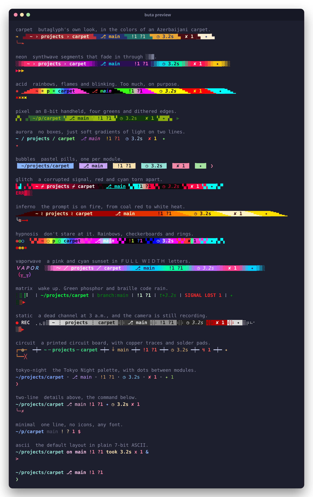</p>

```sh
buta preview                  # see every preset, in your own directory
buta preset carpet --install  # use one (your old config is kept as .bak)
```

| | |
|:---:|:---:|
| 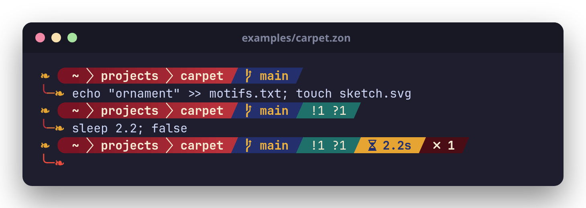<br>**carpet**: the colors of an Azerbaijani carpet | 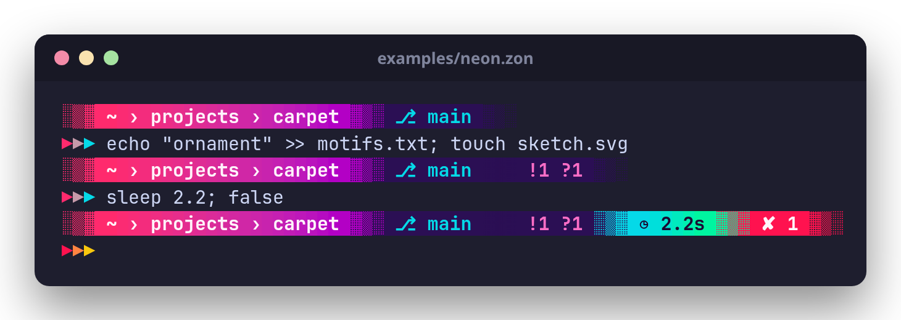<br>**neon**: synthwave, fading in through `░▒▓` |
| 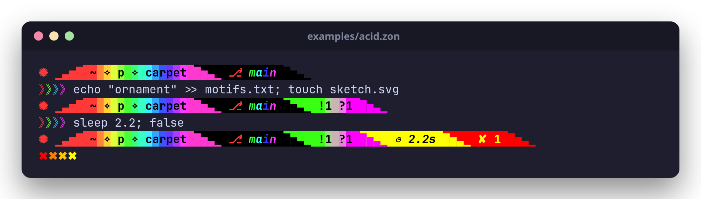<br>**acid**: rainbows and flames, too much on purpose | 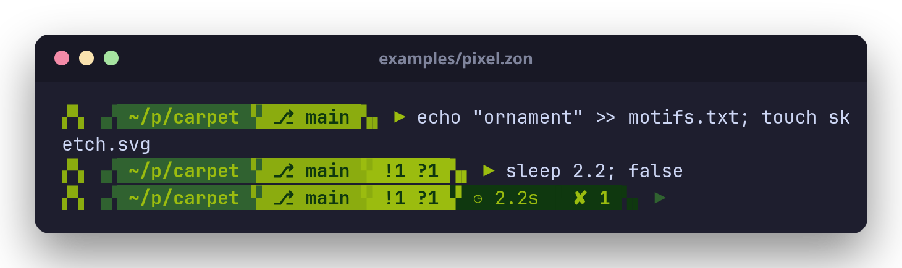<br>**pixel**: an 8-bit handheld |
| 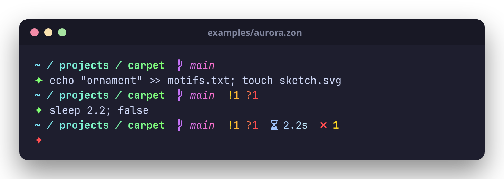<br>**aurora**: soft gradients, no boxes | 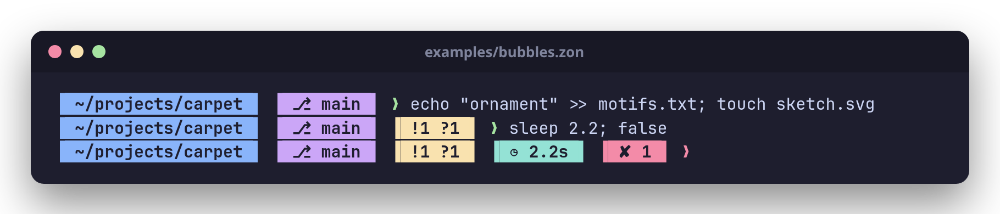<br>**bubbles**: pastel pills |
| 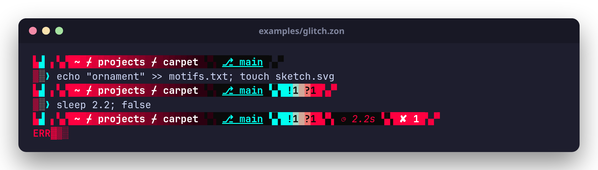<br>**glitch**: a corrupted signal, red and cyan torn apart | 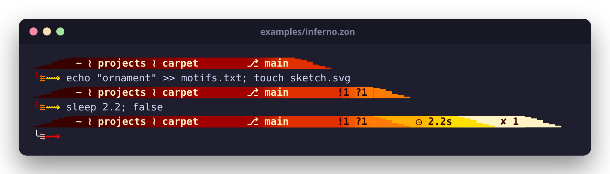<br>**inferno**: on fire, from coal red to white heat |
| 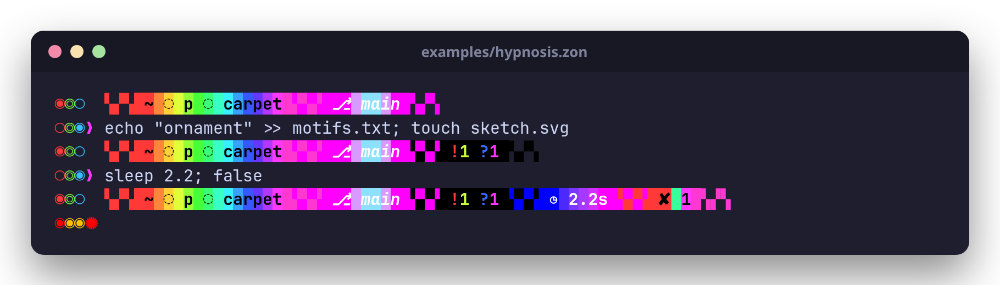<br>**hypnosis**: rainbows, checkerboards and rings | 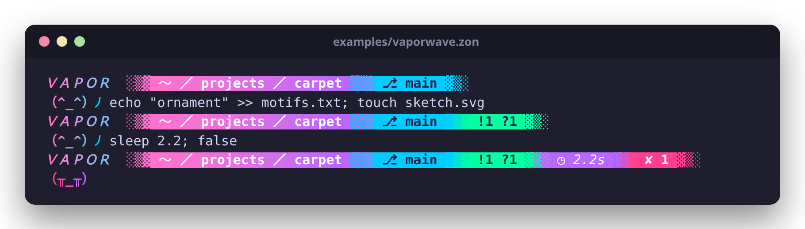<br>**vaporwave**: ＡＥＳＴＨＥＴＩＣ |
| 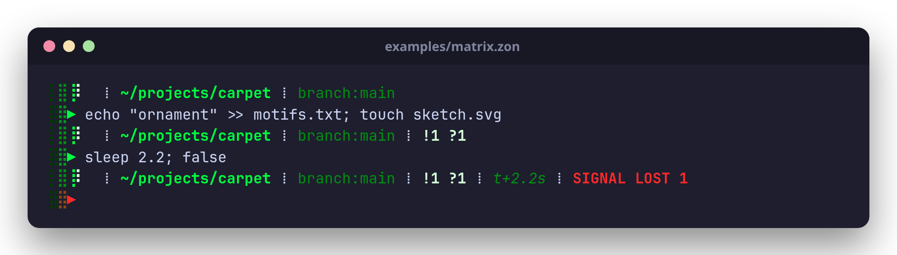<br>**matrix**: green phosphor and braille rain | 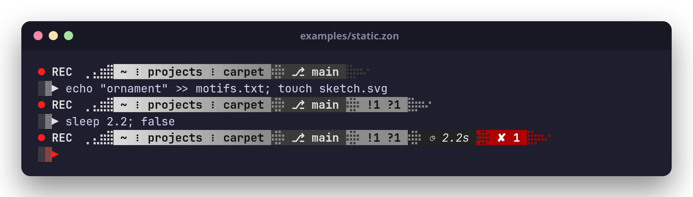<br>**static**: a dead channel, still recording |
| 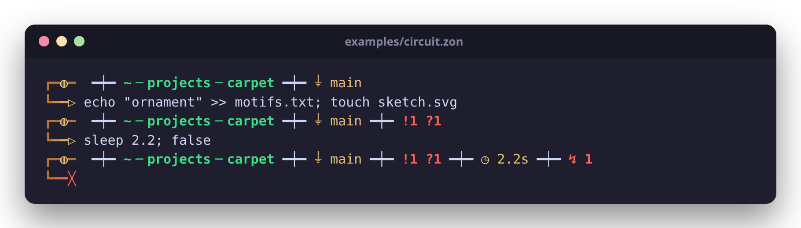<br>**circuit**: copper traces and solder pads | |

Also `tokyo-night`, `two-line`, `minimal` and `ascii`. Their sources are
in [`examples/`](examples).

## Make your own

### In the browser

```sh
buta config
```

This opens an editor in your browser with a live preview, which is
the real prompt drawn in your current directory. Load a preset, drag
modules into place, pick colors and gradients, and choose segment
shapes. **Save** writes your config file, and your next prompt uses it:
press Enter in your terminal and the new look is there. The editor runs
on `127.0.0.1` only, and stops when you click *Done* or press Ctrl-C.

<p align="center">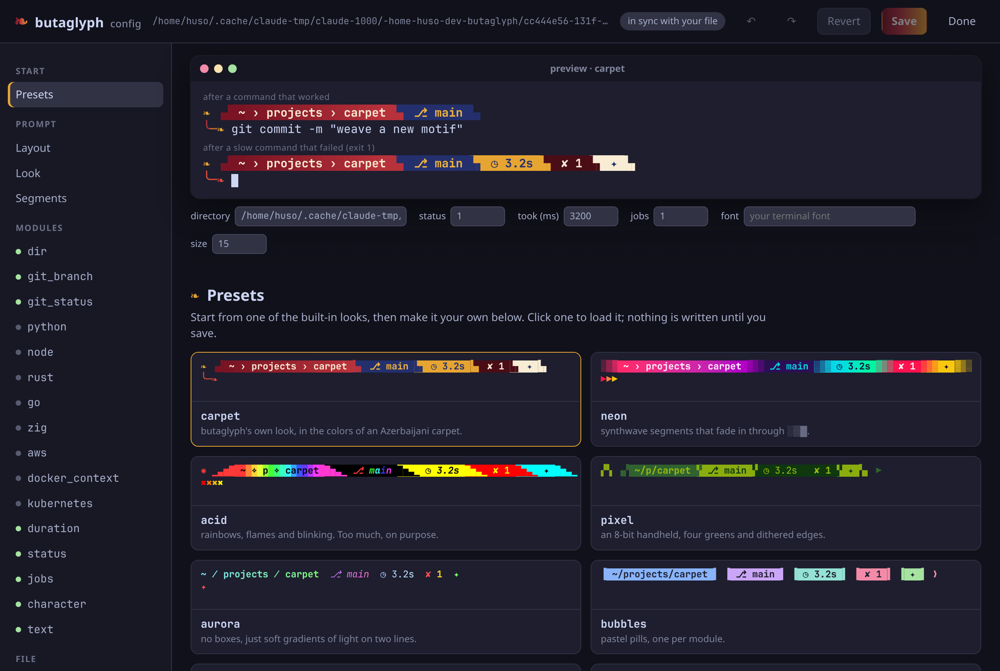</p>

### By hand

Start from a preset (`buta preset carpet --install`), then edit
`~/.config/butaglyph/config.zon`. The next prompt shows the change, and
`buta preview config.zon` shows a file you are still writing.

```zig
.{
    // Which modules, in which order.
    .order = .{ .text, .dir, .git_branch, .git_status, .duration, .status, .line_break, .character },

    // Join modules that have a background into segments.
    .segments = .{ .open = "▗▟", .join = "▙▖", .close = "▙▖" },

    // An ornament at the start.
    .text = .{ .pieces = .{.{ .text = "❧", .style = .{ .fg = "#e6a532" } }} },

    // Colors: "red", "208", "#7aa2f7", a gradient "#a>#b>#c", or "rainbow".
    .dir = .{ .style = .{ .fg = "#ffffff", .bg = "#ff2a6d>#b300c5", .bold = true }, .separator = " ❯ " },
    .git_branch = .{ .style = .{ .fg = "#05d9e8", .bg = "#2b0f54" } },
    .git_status = .{ .style = .{ .fg = "#ff6ec7", .bg = "#2b0f54" } },
    .character = .{ .success_symbol = "╰─❯", .success_style = .{ .fg = "rainbow" } },
}
```

Every option, module and segment shape is in
[docs/configuration.md](docs/configuration.md).

## More

* [docs/configuration.md](docs/configuration.md): all settings, styling,
  modules, shells in detail
* [docs/internals.md](docs/internals.md): the daemon, the design, the git
  reader, development and benchmarks

## License

MIT, see [LICENSE](LICENSE).
