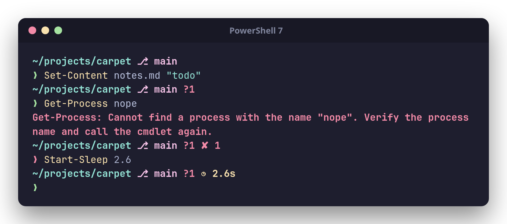

# Configuring butaglyph

Back to the [README](../README.md). For how buta works inside, see
[internals.md](internals.md).

## The editor: `buta config`

`buta config` starts a small web server on `127.0.0.1` and opens the
editor in your browser. It edits the same config file the prompt reads,
so a save shows up in your very next prompt.

* **Live preview.** Every change redraws two sample prompts: one after a
  command that worked, and one after a slow command that failed. The
  preview runs the real `buta prompt` with your edited config, in the
  directory where you started `buta config`; you can change the directory,
  the exit status, the duration and the job count. Set the preview font to
  your terminal's font if you use Nerd Font glyphs.
* **Presets** are drawn the same way in your directory; click one to load it.
* **Layout**: drag modules into order, remove them, add `line_break` for
  a second line.
* **Look and segments**: the glyph set, the separator, and a gallery of
  segment shapes.
* **Every module's options**, including colors, gradients (up to eight
  stops), rainbow and the text style flags. The forms are generated from
  the config's own types, so every option in this document is there.
* **config.zon**: the file that *Save* writes, which you can also edit
  as text.
* Undo and redo (Ctrl+Z, Ctrl+Shift+Z), save (Ctrl+S).

Saving writes only what differs from the defaults. Comments in the file
are not kept, and the file as it was is kept next to it as `config.zon.bak`
(the first time you save in a session).

```sh
buta config               # opens the browser
buta config --no-open     # prints the address instead (e.g. over SSH, with a port forward)
buta config --port 7777   # a fixed port instead of any free one
```

The server answers only requests that carry a random token, which is part
of the address it prints, and only when they name `127.0.0.1` or
`localhost` as the host. Other users on the machine and other web pages
can't read or change your config through it.

## The config file

buta reads its config from `$BUTA_CONFIG` if set, otherwise from
`$XDG_CONFIG_HOME/butaglyph/config.zon`, otherwise from
`~/.config/butaglyph/config.zon` (on Windows `~` is your profile directory,
`%USERPROFILE%`). The file is
[ZON](https://ziglang.org/documentation/master/#ZON) and every field is
optional. If the file is missing, buta uses the defaults. If the file is
invalid, buta prints one located error on stderr (e.g.
`config.zon:3:15: error: ...`) and draws the default prompt, so a broken
config never costs you the prompt.

```zig
.{
    // .unicode (default, any font), .nerd (icons, needs a Nerd Font) or .ascii
    .glyphs = .unicode,
    // Modules in display order; modules left out are never computed.
    .order = .{ .dir, .git_branch, .git_status, .python, .node, .rust, .go, .zig, .java, .ruby, .php, .deno, .bun, .dotnet, .lua, .haskell, .aws, .duration, .status, .jobs, .line_break, .character },
    .separator = " ",
    // Deadline for expensive modules (git, languages), in ms from prompt start.
    .timeout_ms = 100,
    // The cache daemon: .auto (use it, start it when needed), .manual, .off
    .daemon = .auto,

    // Colors: "red", "bright_cyan", "208" (256-color), "#7aa2f7" (truecolor).
    // Style flags: bold, dim, italic, underline. Background: .bg.
    .dir = .{
        .style = .{ .fg = "#7aa2f7", .bold = true },
        .collapse_home = false, // true: ~/dev instead of /home/me/dev
        .home_symbol = "~",
        .max_length = 24, // abbreviate once longer than this (0 = always)
        .abbrev_len = 1,  // ~/d/b/src: characters kept per directory
        .full_dirs = 2,   // trailing directories never abbreviated
    },
    .git_branch = .{ .style = .{ .fg = "magenta" }, .symbol = "on ", .max_length = 32, .timeout_ms = 50 },
    .git_status = .{ .style = .{ .fg = "red" }, .show_counts = true, .untracked = true, .ahead_behind = true },
    .status = .{ .style = .{ .fg = "red", .bold = true }, .signal_names = true },
    .duration = .{ .style = .{ .fg = "yellow" }, .min_ms = 2000 },
    .jobs = .{ .style = .{ .fg = "blue" } },
    .character = .{ .success_symbol = "❯", .failure_symbol = "✗" },
}
```

## Styling

Every `style` (and `success_style`/`failure_style`) takes:

```zig
.{
    .fg = "#ff2a6d",          // "red", "bright_cyan", "208" or "#rrggbb"
    .bg = "#7a1424>#b8323b",  // a gradient: two or more colors joined by ">"
    .bold = true, .dim = false, .italic = false, .underline = false,
    .blink = false, .inverse = false, .strikethrough = false,
}
```

* **Gradients.** `"#ff0080>#7928ca>#00e5ff"` runs across the module's
  text, one color per character, through up to eight stops. The colors are
  blended in [OKLab](https://bottosson.github.io/posts/oklab/), so a red
  to blue gradient passes through purple instead of mud. Named and 256
  colors work as stops too.
* **`"rainbow"`** runs through the whole spectrum, for `fg` or `bg`.
* Gradients need a truecolor terminal. Most terminals are; where one
  isn't, the colors are approximated or ignored, and the text still shows.

**Segments.** With `.segments` set, every module that has a background
becomes a segment, and neighboring segments are joined by a glyph drawn
in both of their colors (the edges of a gradient, if they have one).
Modules without a background are drawn as usual, between runs of
segments.

```zig
.segments = .{
    .open = "▐",  // before a run of segments (the default)
    .join = "▌",  // between two segments; null: separate pills
    .close = "▌", // after a run
    .padding = " ",      // inside each segment, on both sides
},
```

Shapes made of block elements work with every font (most terminals
draw these characters themselves, filling the cell):

| Shape     | open    | join    | close   | Used by  |
|-----------|---------|---------|---------|----------|
| half      | `▐`     | `▌`     | `▌`     | default  |
| stairs    | `▗▟`    | `▙▖`    | `▙▖`    | carpet   |
| shade     | `░▒▓`   | `▓▒░`   | `▓▒░`   | neon     |
| dither    | `▗▞`    | `▞`     | `▚▖`    | pixel    |
| equalizer | `▁▃▅▇`  | `▇▅▃▁`  | `▇▅▃▁`  | acid     |
| pills     | `▐`     | `null`  | `▌`     | bubbles  |

With a Nerd Font, the powerline shapes are available too. They are in
the Private Use Area, so without such a font they show as boxes:

| Shape     | open       | join       | close      |
|-----------|------------|------------|------------|
| arrow     | `\u{e0b2}` | `\u{e0b0}` | `\u{e0b0}` |
| round     | `\u{e0b6}` | `\u{e0b4}` | `\u{e0b4}` |
| slant     | `\u{e0ba}` | `\u{e0bc}` | `\u{e0bc}` |
| flame     | `\u{e0c2}` | `\u{e0c0}` | `\u{e0c0}` |
| pixel     | `\u{e0c7}` | `\u{e0c6}` | `\u{e0c6}` |

**Ornaments.** The `text` module draws fixed pieces of styled text:
motifs, frames, labels. List `.text` in `order` wherever it should go
(several times if you like):

```zig
.order = .{ .text, .dir, .git_branch, .line_break, .character },
.text = .{ .pieces = .{
    .{ .text = "╭─", .style = .{ .fg = "#585b70" } },
    .{ .text = "❧", .style = .{ .fg = "#e6a532>#b8323b" } },
} },
.character = .{ .success_symbol = "╰─❯" },
```

**Paths.** `.dir = .{ .separator = " ❯ " }` draws `~ ❯ dev ❯ butaglyph`;
any string works (`" › "`, `" • "`, `" ∕ "`, or `" \u{e0b1} "`, a
powerline chevron, with a Nerd Font). The root of an absolute path stays
`/`.

## Modules

| Module       | Shows                                                         | Main options |
|--------------|---------------------------------------------------------------|--------------|
| `dir`        | Working directory, with fish-style abbreviation of long paths (UTF-8 aware). Your home directory is shown whole (`/home/me/d/b/src`), or as `~` with `collapse_home`. Windows drives and UNC roots are kept whole | `collapse_home`, `home_symbol`, `separator`, `abbreviate`, `max_length`, `abbrev_len`, `full_dirs` |
| `git_branch` | Branch from `.git/HEAD`, or the short hash when HEAD is detached. Works in subdirectories, worktrees and submodules (`.git` files with `gitdir:`) | `symbol`, `detached_symbol`, `hash_length`, `max_length`, `timeout_ms` |
| `git_status` | Conflicted (`=`), staged (`+`), renamed (`»`), modified (`!`), deleted (`✘`) and untracked (`?`) paths, and commits ahead of (`⇡`) and behind (`⇣`) the upstream. Hidden when the tree is clean and in sync | `*_symbol`, `show_counts`, `untracked`, `ahead_behind`, `worktree`, `timeout_ms` |
| `status`     | The last exit code, if non-zero. `130` is shown as `INT`, and so on | `symbol`, `signal_names` |
| `duration`   | How long the last command ran, if longer than `min_ms`        | `symbol`, `min_ms` |
| `jobs`       | Number of background jobs. Not in the default order           | `symbol`, `min`, `count_from` |
| `character`  | The prompt symbol: green on success, red on failure           | `success_symbol`, `failure_symbol`, `*_style`, `suffix` |
| `line_break` | A newline, for multi-line prompts                             | none |
| `text`       | Fixed pieces of styled text: ornaments, frames, labels        | `pieces` |
| `python`     | Python version, and the active virtual or conda environment's name. Shown in a Python project or wherever an environment is active | `symbol`, `version_prefix`, `detect`, `show_env`, `timeout_ms` |
| `node`       | Node.js version, in a JavaScript project                      | `symbol`, `version_prefix`, `detect`, `timeout_ms` |
| `rust`       | The active rustup toolchain's `rustc` version, in a Cargo project | `symbol`, `version_prefix`, `detect`, `timeout_ms` |
| `go`         | Go version, in a Go module or workspace                       | `symbol`, `version_prefix`, `detect`, `timeout_ms` |
| `zig`        | Zig version, in a Zig project                                 | `symbol`, `version_prefix`, `detect`, `timeout_ms` |
| `java`, `ruby`, `php`, `deno`, `bun`, `dotnet`, `lua`, `haskell` | The language's version, in a project of it (`dotnet`: the SDK, `haskell`: GHC) | `symbol`, `version_prefix`, `detect`, `timeout_ms` |
| `aws`        | The AWS profile and region set in this shell                  | `symbol`, `show_region`, `timeout_ms` |
| `docker_context` | The Docker context, unless it is `default`. Not in the default order | `symbol`, `timeout_ms` |
| `kubernetes` | The Kubernetes context and its namespace. Not in the default order | `symbol`, `show_namespace`, `timeout_ms` |
| `os`         | Your distribution's logo with `.glyphs = .nerd` (Arch, Debian, Fedora, NixOS, Ubuntu, macOS, Windows and more; Arch-based systems get Arch's), its name otherwise. Not in the default order | `symbol`, `show_name` |
| `user`       | `user@host`, in `root_style` for root. Not in the default order | `show_user`, `show_host`, `separator`, `ssh_only`, `root_style` |

Every module except `line_break` and `text` has a `style` (or
`success_style`/`failure_style`) and a `symbol` override; leaving `symbol`
unset uses the active glyph set.

Untracked files are counted like `git status` does: an untracked
directory counts once (`dir/`), and the repository's
`status.showUntrackedFiles` (`no`, `normal`, `all`) applies. Set
`.git_status = .{ .untracked = false }` to skip the walk of the work tree
altogether.

### Language modules

`python`, `node`, `rust`, `go`, `zig`, `java`, `ruby`, `php`, `deno`,
`bun`, `dotnet`, `lua` and `haskell` show up only inside a project of
their language: a directory that holds one of the `detect` files, or
below one (up to your home directory), or a working directory with a file
of one of the `detect` extensions (`*.csproj`, `*.cabal`). Each module shows its tool's
version, and the module alone (no version) when the tool isn't
installed.

```zig
.rust = .{
    .style = .{ .fg = "#dea584" },
    .version_prefix = "",  // "1.82.0" instead of "v1.82.0"
    .detect = .{ .files = .{ "Cargo.toml" }, .search_parents = false },
},
```

| Module   | Default `detect` files |
|----------|------------------------|
| `python` | `pyproject.toml`, `requirements.txt`, `setup.py`, `setup.cfg`, `Pipfile`, `.python-version`, `tox.ini`, `uv.lock` |
| `node`   | `package.json`, `.nvmrc`, `.node-version` |
| `rust`   | `Cargo.toml`, `rust-toolchain.toml`, `rust-toolchain` |
| `go`     | `go.mod`, `go.work` |
| `zig`    | `build.zig`, `build.zig.zon` |
| `java`   | `pom.xml`, `build.gradle(.kts)`, `settings.gradle(.kts)`, `.java-version`, `.sdkmanrc`; `*.java` |
| `ruby`   | `Gemfile`, `.ruby-version`, `Rakefile`; `*.gemspec` |
| `php`    | `composer.json`, `.php-version`; `*.php` |
| `deno`   | `deno.json`, `deno.jsonc`, `deno.lock` |
| `bun`    | `bun.lock`, `bun.lockb`, `bunfig.toml` |
| `dotnet` | `global.json`, `Directory.Build.props`, `Directory.Build.targets`, `Directory.Packages.props`; `*.csproj`, `*.fsproj`, `*.vbproj`, `*.sln`, `*.slnx` |
| `lua`    | `.lua-version`, `.luarc.json`, `stylua.toml`; `*.lua`, `*.rockspec` |
| `haskell`| `stack.yaml`, `cabal.project`, `package.yaml`; `*.cabal`, `*.hs` |

Where it can, buta reads the version from a file instead of running the
tool. A virtual environment's version comes from its `pyvenv.cfg`, and
Go's comes from the `VERSION` file of the installation, Java's from the
JDK's `release` file (no JVM starts), and a `global.json` that pins the
.NET SDK is read as is. For Rust, buta
picks the toolchain the way rustup does: `$RUSTUP_TOOLCHAIN`, then
`rustup override` and `rust-toolchain` files from the working directory
up, then the default. It then asks that toolchain's own `rustc`, so the
rustup proxy never runs and a prompt never installs a toolchain.

Anything else runs once (`node --version`, `zig version`). The answer is
kept in `~/.cache/butaglyph/versions` (`$XDG_CACHE_HOME`, or
`%LOCALAPPDATA%` on Windows), keyed by the binary's path, size, mtime
and inode. When you upgrade the tool, the binary changes and buta asks
again. Shims of version managers (pyenv, rbenv, asdf, mise, volta) give a
different answer in each directory without changing on disk, so they are
asked on every prompt.

The first prompt in a new project waits for that one run, up to the
module's deadline. The tool runs in a small helper process of its own,
which outlives the prompt: a tool slower than the deadline is left out of
that one prompt, and the next one finds its answer in the cache. It is
asked only once either way.

### Context modules

`aws`, `docker_context` and `kubernetes` show where your commands will
run. They read the same files and variables as the CLIs and never run
them:

* **`aws`**: `$AWS_PROFILE` (or `$AWS_DEFAULT_PROFILE`, or aws-vault's
  `$AWS_VAULT`) and `$AWS_REGION` (or `$AWS_DEFAULT_REGION`). If no region
  is set in the environment, the region comes from the profile's section
  in `~/.aws/config` (`$AWS_CONFIG_FILE`). The module is hidden unless a
  profile or a region is set in your shell.
* **`docker_context`**: `$DOCKER_CONTEXT`, else `currentContext` in
  `~/.docker/config.json` (`$DOCKER_CONFIG`). Hidden for `default`.
* **`kubernetes`**: `current-context` from `$KUBECONFIG` (merged the way
  kubectl merges it) or `~/.kube/config`, with that context's namespace.
  Only the block-style YAML that kubectl writes is understood.

`docker_context` and `kubernetes` are not in the default order, because
a Docker Desktop install or an old kubeconfig would show them everywhere.
Add them to `.order` if you want them:

```zig
.order = .{ .dir, .git_branch, .git_status, .kubernetes, .line_break, .character },
.kubernetes = .{ .style = .{ .fg = "#326ce5" }, .show_namespace = true },
```

Set `BUTA_DEBUG=1` to have modules report their errors and missed
deadlines on stderr.

## Shells in detail

| Shell      | Add to                       | Line                                                   |
|------------|------------------------------|--------------------------------------------------------|
| bash       | `~/.bashrc`                  | `eval "$(buta init bash)"`                             |
| zsh        | `~/.zshrc`                   | `eval "$(buta init zsh)"`                              |
| fish       | `~/.config/fish/config.fish` | `buta init fish \| source`                             |
| PowerShell | `$PROFILE`                   | `Invoke-Expression (& buta init powershell \| Out-String)` |

`buta init` prints a small hook script that records each command's exit
status and duration, then calls `buta prompt`. The script uses the absolute
path of the `buta` binary that generated it, so the hooks don't depend on
`$PATH`.

* **bash** uses `PROMPT_COMMAND` together with `PS0`. Command durations need
  bash ≥ 4.4, and millisecond precision needs bash ≥ 5.0 (`$EPOCHREALTIME`).
  Older versions still get every other module.
* **zsh** uses `preexec`/`precmd` and `$EPOCHREALTIME`. It also enables
  `prompt_subst`.
* **fish** uses `fish_postexec` and `$CMD_DURATION`, and defines `fish_prompt`.
* **PowerShell** (Windows PowerShell 5.1 and PowerShell 7+, on any
  platform) defines `prompt`. It reads the duration from the history,
  passes PowerShell's location with `--cwd` (it isn't the process's working
  directory), keeps `$?` and `$LASTEXITCODE` intact, and tells PSReadLine
  how tall a multi-line prompt is. `pwsh` is accepted as a name too.
* **Windows**: PowerShell is the native choice. Under Git Bash, MSYS2 or
  Cygwin, `buta init bash` (or zsh, fish) writes the path of `buta.exe`
  in `C:/...` form, which those shells can run; this is less tested than
  PowerShell. Paths are shown with `/` (`C:/Users/me/dev`, or `~/dev`
  under your profile directory).

<p align="center"></p>

You can also call `buta prompt` directly:

```sh
buta prompt --shell zsh --status 1 --duration-ms 5300 --jobs 2
```
